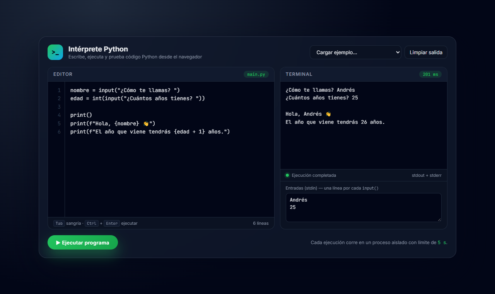

# Intérprete Python web

Editor y terminal de Python en el navegador. Escribes código, defines las entradas para `input()` y el servidor lo ejecuta y devuelve la salida al instante.



## Características

- **Editor de código** con números de línea, sangría con <kbd>Tab</kbd> y ejecución con <kbd>Ctrl</kbd> + <kbd>Enter</kbd>.
- **Entrada estándar simulada**: cada línea del cuadro *stdin* responde a un `input()`, y se muestra en la salida como en una terminal real.
- **Ejecución aislada**: cada programa corre en un proceso de Python independiente (`python -I`) con un **límite de 5 segundos**, así que un bucle infinito no bloquea el servidor.
- **Errores legibles**: los tracebacks se muestran en rojo y apuntan a la línea exacta de tu código.
- **Ejemplos listos para cargar**: Fibonacci, FizzBuzz, clases y herencia, errores…
- Tiempo de ejecución de cada programa y diseño adaptable a móvil.

## Tecnologías

Python · Flask · JavaScript (Fetch API) · HTML · CSS

## Cómo ejecutarlo

```bash
git clone https://github.com/Ramizzz8/interprete-python-web.git
cd interprete-python-web
python -m venv .venv
.venv\Scripts\activate        # En Linux/macOS: source .venv/bin/activate
pip install -r requirements.txt
python app.py
```

Abre <http://127.0.0.1:5000> en el navegador.

## Cómo funciona

1. El frontend envía el código y las entradas a `POST /api/ejecutar` en formato JSON.
2. Flask lanza un proceso de Python con `subprocess.run`, pasando las entradas por *stdin* y con un tiempo límite.
3. Un pequeño script de arranque registra el código como `main.py`, muestra en la salida lo que se responde a cada `input()` y limpia los tracebacks.
4. La salida (stdout + stderr), el resultado y el tiempo vuelven al navegador como JSON.

> ⚠️ Es un proyecto pensado para uso local o educativo: ejecuta código arbitrario en la máquina del servidor, así que no debe exponerse públicamente sin un sandbox real (contenedores, límites de memoria, etc.).

## Autor

**Andrés Ramírez** — [GitHub](https://github.com/Ramizzz8) · [LinkedIn](https://www.linkedin.com/in/andr%C3%A9s-ram%C3%ADrez-011936349/)
